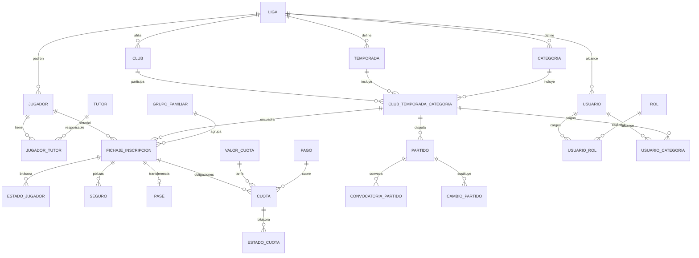

# Club Agrario Rocamora — Diseño del esquema de base de datos

> Derivado de `docs/DOMINIO.md` (modelo del §8 del informe) y de §8.1 del informe
> (restricciones, índices únicos e invariantes).
> Motor: **PostgreSQL 16**.
> **Estado:** diseño definido; las migraciones todavía no existen en el repositorio.
> Lo marcado como *(derivado)* es una decisión de implementación necesaria para materializar el modelo y
> **no** está explícita en el informe: si el equipo la cambia, corresponde actualizar este documento y el ADR.

## 1. Convenciones

- **Claves primarias:** `integer` con `generated always as identity` para las entidades con PK declarada en el
  ERD (`id_liga`, `id_club`, …). Las tablas puente sin surrogate usan PK compuesta (ver §2).
  *(derivado: el informe declara `int`; no se adopta UUID.)*
- **Nombres:** tablas en `snake_case` y singular, tal como el ERD (`fichaje_inscripcion`, `club_temporada_categoria`).
  Columnas en `snake_case` con el prefijo de la entidad cuando corresponde (`id_club`, `id_temporada`).
  Sin acentos en identificadores.
- **Dinero:** `numeric(12,2)` con `check (>= 0)` en todo monto.
- **Fechas:** `date` para datos de calendario deportivo y administrativo (`fecha_alta`, `fecha_vencimiento`).
  **Timestamps con zona** (`timestamptz`) para eventos y auditoría (`fecha_hora`, `fecha_pago`,
  `fecha_creacion`). *(derivado)*
- **Auditoría:** `created_at` / `updated_at timestamptz not null default now()` en entidades principales;
  `updated_at` lo mantiene la aplicación (sin triggers). Las bitácoras (`estado_jugador`, `estado_cuota`) usan
  solo su timestamp de dominio. *(derivado)*
- **Borrado:** `on delete restrict` entre entidades y `on delete cascade` solo para hijos directos
  (bitácoras e ítems dependientes). Las bajas son **lógicas** (`fichaje_inscripcion.fecha_baja`); no se esperan
  borrados duros de jugadores ni clubes. *(derivado)*

## 2. Mapa entidad → tabla

### 2.1 Liga, club y participación

| Entidad | Tabla | Columnas | PK / Notas |
|---|---|---|---|
| Liga | `liga` | `id_liga`, `nombre`, `provincia`, `activa` | PK `id_liga` |
| Club | `club` | `id_club`, `id_liga`, `nombre`, `cuit`, `domicilio`, `escudo_url`, `color_primario`, `color_secundario`, `activo` | FK `id_liga`. `cuit` único |
| Temporada | `temporada` | `id_temporada`, `id_liga`, `anio`, `fecha_inicio`, `fecha_fin`, `activa`, `fecha_cierre` | FK `id_liga`. Una sola activa por liga |
| Categoria | `categoria` | `id_categoria`, `id_liga`, `anio_desde`, `anio_hasta`, `nombre` | FK `id_liga`. `check (anio_desde <= anio_hasta)` |
| Club_Temporada_Categoria | `club_temporada_categoria` | `id_club_temporada_categoria`, `id_club`, `id_temporada`, `id_categoria`, `activa` | PK propia. Único `(id_club, id_temporada, id_categoria)` |

### 2.2 Padrón y tutores

| Entidad | Tabla | Columnas | PK / Notas |
|---|---|---|---|
| Jugador | `jugador` | `id_jugador`, `id_liga`, `dni`, `nombre`, `apellido`, `fecha_nacimiento`, `lugar_nacimiento`, `domicilio`, `foto_url`, `fecha_apto_medico` | Único `(dni, id_liga)` |
| Tutor | `tutor` | `id_tutor`, `dni`, `nombre`, `apellido`, `telefono`, `domicilio` | `dni` único (global) |
| Jugador_Tutor | `jugador_tutor` | `id_jugador`, `id_tutor`, `vinculo`, `fecha_desde`, `fecha_hasta` | PK compuesta `(id_jugador, id_tutor, fecha_desde)` *(derivado)* |

### 2.3 Fichaje y derivados

| Entidad | Tabla | Columnas | PK / Notas |
|---|---|---|---|
| Grupo_Familiar | `grupo_familiar` | `id_grupo`, `id_club`, `apellido_familia`, `observaciones` | FK `id_club` |
| Fichaje_Inscripcion | `fichaje_inscripcion` | `id_fichaje`, `id_club_temporada_categoria`, `id_jugador`, `id_grupo`, `tipo_fichaje`, `porcentaje_beca`, `consentimiento_imagen`, `nro_carnet_liga`, `fecha_alta`, `fecha_baja` | Índice único parcial de vigencia (§3.2) |
| Estado_Jugador | `estado_jugador` | `id_estado_jugador`, `id_fichaje`, `id_usuario`, `fecha_hora`, `valor`, `motivo` | Bitácora append-only |
| Pase | `pase` | `id_pase`, `id_fichaje`, `id_club_cedente`, `id_club_cesionario`, `club_cedente_nombre`, `club_cesionario_nombre`, `fecha_inicio`, `fecha_fin` | `id_fichaje` único (0..1) |
| Seguro | `seguro` | `id_seguro`, `id_fichaje`, `fecha_alta`, `fecha_vencimiento`, `nro_poliza` | FK `id_fichaje` |

### 2.4 Partidos

| Entidad | Tabla | Columnas | PK / Notas |
|---|---|---|---|
| Partido | `partido` | `id_partido`, `id_club_temporada_categoria`, `fecha_hora`, `rival`, `condicion`, `cancha`, `estado`, `gol_local`, `gol_visitante` | FK `id_club_temporada_categoria` |
| Convocatoria_Partido | `convocatoria_partido` | `id_partido`, `id_jugador`, `dorsal`, `goles`, `tarjetas_amarillas`, `tarjeta_roja` | PK compuesta `(id_partido, id_jugador)` *(derivado)*. Único `(id_partido, dorsal)` |
| Cambio_Partido | `cambio_partido` | `id_cambio`, `id_partido`, `id_jugador_sale`, `id_jugador_entra`, `minuto` | FK `id_partido` |

### 2.5 Finanzas

| Entidad | Tabla | Columnas | PK / Notas |
|---|---|---|---|
| Pago | `pago` | `id_pago`, `id_club`, `id_usuario_cobro`, `nro_recibo`, `fecha_pago`, `medio_pago`, `monto_total`, `estado`, `motivo_anulacion` | Único `(id_club, nro_recibo)` |
| Cuota | `cuota` | `id_cuota`, `id_club`, `id_jugador`, `id_fichaje`, `id_valor_cuota`, `id_pago`, `periodo` *(formato `YYYY-MM`)*, `fecha_vencimiento`, `monto_base`, `descuento_aplicado`, `estado` | Único `(id_fichaje, periodo)` |
| Valor_Cuota | `valor_cuota` | `id_valor_cuota`, `id_club`, `precio`, `fecha_vigencia` | Tarifa versionada |
| Estado_Cuota | `estado_cuota` | `id_estado_cuota`, `id_cuota`, `fecha_hora`, `valor_estado` | Bitácora append-only |

### 2.6 Seguridad y notificaciones

| Entidad | Tabla | Columnas | PK / Notas |
|---|---|---|---|
| Usuario | `usuario` | `id_usuario`, `id_liga`, `id_club`, `keycloak_sub`, `username`, `email`, `nombre`, `apellido`, `telefono`, `dni`, `activo` | `keycloak_sub` único y `not null`; alcance excluyente |
| Rol | `rol` | `id_rol`, `nombre` | Catálogo espejo |
| Usuario_Rol | `usuario_rol` | `id_usuario`, `id_rol`, `fecha_inicio`, `fecha_fin` | PK compuesta `(id_usuario, id_rol, fecha_inicio)` *(derivado)*. Un cargo vigente por usuario *(derivado)* |
| Usuario_Categoria | `usuario_categoria` | `id_usuario`, `id_club_temporada_categoria`, `rol_en_categoria` | PK compuesta `(id_usuario, id_club_temporada_categoria)` *(derivado)* |
| Notificacion | `notificacion` | `id_notificacion`, `id_club`, `id_usuario`, `id_jugador`, `tipo_notificacion`, `titulo`, `mensaje`, `fecha_creacion`, `leida` | `id_jugador` nullable (avisos de sistema) |

## 3. Restricciones, índices e invariantes

Traducción directa de §8.1 del informe a DDL. Los nombres son sugeridos; lo que importa es la restricción.

### 3.1 Unicidades e integridad estructural

```sql
-- 1. Jugador único por DNI dentro de la liga
ALTER TABLE jugador
  ADD CONSTRAINT uq_jugador_dni_liga UNIQUE (dni, id_liga);

-- Temporada (§8.1.3): una única activa por liga y cierre de ciclo coherente
CREATE UNIQUE INDEX uq_temporada_activa_liga
  ON temporada (id_liga)
  WHERE activa;

ALTER TABLE temporada
  ADD CONSTRAINT ck_temporada_cierre
  CHECK (NOT (activa AND fecha_cierre IS NOT NULL));

-- 3. Participación deportiva única y rango de años coherente
ALTER TABLE club_temporada_categoria
  ADD CONSTRAINT uq_ctc_club_temporada_categoria UNIQUE (id_club, id_temporada, id_categoria);
ALTER TABLE categoria
  ADD CONSTRAINT ck_categoria_rango CHECK (anio_desde <= anio_hasta);

-- 4. Tutores globales e identidad de usuario
ALTER TABLE tutor ADD CONSTRAINT uq_tutor_dni UNIQUE (dni);
ALTER TABLE usuario ALTER COLUMN keycloak_sub SET NOT NULL;
ALTER TABLE usuario ADD CONSTRAINT uq_usuario_keycloak_sub UNIQUE (keycloak_sub);

-- 5. Unicidad institucional, financiera y deportiva
ALTER TABLE club ADD CONSTRAINT uq_club_cuit UNIQUE (cuit);
ALTER TABLE pago ADD CONSTRAINT uq_pago_recibo UNIQUE (id_club, nro_recibo);
ALTER TABLE convocatoria_partido ADD CONSTRAINT uq_convocatoria_dorsal UNIQUE (id_partido, dorsal);
ALTER TABLE convocatoria_partido ADD CONSTRAINT uq_convocatoria_jugador UNIQUE (id_partido, id_jugador);

-- 6. Prevención de doble facturación
ALTER TABLE cuota ADD CONSTRAINT uq_cuota_fichaje_periodo UNIQUE (id_fichaje, periodo);

-- 7. El período de cuota es 'YYYY-MM' (ver §2.5); el CHECK evita valores no parseables
ALTER TABLE cuota
  ADD CONSTRAINT ck_cuota_periodo_formato
  CHECK (periodo ~ '^[0-9]{4}-(0[1-9]|1[0-2])$');
```

### 3.2 Fuente única de verdad de la vigencia

```sql
-- Un jugador no puede estar fichado en dos clubes a la vez.
-- fecha_baja IS NULL es el único predicado de vigencia: no hay columna is_actual.
CREATE UNIQUE INDEX uq_fichaje_vigente
  ON fichaje_inscripcion (id_jugador)
  WHERE fecha_baja IS NULL;

-- Un usuario no puede tener dos cargos vigentes a la vez (historial de cargos de RF05).
-- fecha_fin IS NULL es el predicado de vigencia del cargo.
CREATE UNIQUE INDEX uq_usuario_rol_vigente
  ON usuario_rol (id_usuario)
  WHERE fecha_fin IS NULL;
```

### 3.3 CHECKs sobre estados enumerados

```sql
ALTER TABLE cuota
  ADD CONSTRAINT ck_cuota_estado
  CHECK (estado IN ('Pendiente', 'Pagada', 'Adeudada', 'Anulada'));

ALTER TABLE estado_cuota
  ADD CONSTRAINT ck_estado_cuota_valor
  CHECK (valor_estado IN ('Pendiente', 'Pagada', 'Adeudada', 'Anulada'));

ALTER TABLE estado_jugador
  ADD CONSTRAINT ck_estado_jugador_valor
  CHECK (valor IN ('Activo', 'Inactivo'));

ALTER TABLE pago
  ADD CONSTRAINT ck_pago_estado
  CHECK (estado IN ('Registrado', 'Anulado'));

ALTER TABLE partido
  ADD CONSTRAINT ck_partido_estado
  CHECK (estado IN ('Programado', 'Jugado', 'Suspendido'));

ALTER TABLE partido
  ADD CONSTRAINT ck_partido_condicion
  CHECK (condicion IN ('Local', 'Visitante'));

ALTER TABLE fichaje_inscripcion
  ADD CONSTRAINT ck_tipo_fichaje
  CHECK (tipo_fichaje IN ('Propio', 'A_Prestamo', 'Libre'));
```

### 3.4 Alcance institucional del usuario

```sql
-- Un usuario pertenece a una liga o a un club, nunca a ambos ni a ninguno.
ALTER TABLE usuario
  ADD CONSTRAINT ck_usuario_alcance
  CHECK ((id_liga IS NOT NULL) <> (id_club IS NOT NULL));
```

### 3.5 Pases con clubes externos

```sql
-- Si el club no está registrado, el nombre es obligatorio.
ALTER TABLE pase
  ADD CONSTRAINT ck_pase_cedente
  CHECK (id_club_cedente IS NOT NULL OR club_cedente_nombre IS NOT NULL);

ALTER TABLE pase
  ADD CONSTRAINT ck_pase_cesionario
  CHECK (id_club_cesionario IS NOT NULL OR club_cesionario_nombre IS NOT NULL);
```

### 3.6 Invariantes que no se pueden expresar como constraint

Se implementan en `ms-backend`, dentro de una transacción:

1. **Baja lógica atómica (RN-12):** insertar `estado_jugador` con `valor = 'Inactivo'` (con `id_usuario` y
   `motivo`) implica escribir `fichaje_inscripcion.fecha_baja` en el mismo commit.
2. **Estado canónico de cuota:** `cuota.estado` se actualiza junto con la fila de `estado_cuota`.
3. **Aislamiento en convocatorias y cambios (§8.1.12):** solo se convoca o sustituye a jugadores con fichaje
   vigente en el club dueño del partido; en `cambio_partido`, ambos jugadores deben estar en
   `convocatoria_partido` del mismo encuentro.
4. **Autorización sobre tutores (§8.1.13):** toda consulta a `tutor` / `jugador_tutor` desde un usuario de club
   debe verificar que el jugador tiene fichaje vigente en ese club.
5. **Máximo 2 tutores vigentes por jugador (RN-02):** validación de aplicación; un `count` sobre
   `jugador_tutor where fecha_hasta is null` antes de insertar.
6. **Cierre de temporada (RN-18, RN-22):** al cerrar, dentro de la misma transacción, se pasa a `Suspendido`
   todo `partido` de esa temporada que siga en `Programado`, y la temporada queda inmutable (reabrir → 409).
   Después del cierre se rechaza la creación de `partido`, `fichaje_inscripcion` y `cuota` en cualquier
   `club_temporada_categoria` de ese ciclo —resolviendo la temporada por join— pero **se permite** insertar
   `pago` y transicionar `estado_cuota` sobre cuotas ya emitidas. Los fichajes vigentes **no** se cierran.
7. **Renovación de planteles idempotente (RN-20):** aplica solo a fichajes con `tipo_fichaje = 'Propio'`.
   Crea el fichaje nuevo y cierra el anterior en una transacción; re-ejecutar no duplica. El índice
   `uq_fichaje_vigente` actúa como red de seguridad, pero la operación debe reportar omitidos, no fallar.
8. **Job diario de cumpleaños sin duplicados** *(derivado)*: antes de insertar en `notificacion`, verificar que
   no exista ya una del mismo `(id_usuario, id_jugador, tipo_notificacion)` para la fecha del día. El informe no
   lo declara, pero el job es `@Scheduled` y puede reejecutarse.
9. **Rango etario inmutable con historia (RN-23):** editar `categoria.anio_desde` / `anio_hasta` se rechaza si
   la categoría tiene filas en `club_temporada_categoria` cuyo `temporada.fecha_cierre` no sea nulo. Requiere
   join, por lo tanto es validación de aplicación.

### 3.7 Índices por camino de lectura *(derivado)*

```sql
CREATE INDEX idx_partido_ctc_fecha      ON partido (id_club_temporada_categoria, fecha_hora);
CREATE INDEX idx_fichaje_ctc            ON fichaje_inscripcion (id_club_temporada_categoria);
CREATE INDEX idx_cuota_fichaje_estado   ON cuota (id_fichaje, estado);
CREATE INDEX idx_cuota_club_periodo     ON cuota (id_club, periodo);
CREATE INDEX idx_estado_jugador_fichaje ON estado_jugador (id_fichaje, fecha_hora DESC);
CREATE INDEX idx_estado_cuota_cuota     ON estado_cuota (id_cuota, fecha_hora DESC);
CREATE INDEX idx_notificacion_usuario   ON notificacion (id_usuario, leida);
CREATE INDEX idx_jugador_fecha_nac      ON jugador (fecha_nacimiento);
```

## 4. Decisiones clave

1. **PK enteras:** el ERD declara `int`; se materializa con `identity`. Cambiar a UUID es una decisión abierta,
   no un detalle de implementación.
2. **`fecha_baja IS NULL` + índice parcial** en lugar de `is_actual`: una sola fuente de verdad, garantizada
   por la base (ver `adr/0003`).
3. **`Cuota.id_fichaje` es el vínculo canónico**; `id_club` e `id_jugador` se conservan por rendimiento y
   filtrado multi-tenant, pero siempre coherentes con el fichaje.
4. **Bitácoras append-only** (`estado_jugador`, `estado_cuota`) + columna de estado vigente (`cuota.estado`).
   En `estado_jugador` **no** hay caché: la vigencia la da el fichaje (ver `DOMINIO.md` §4.2).
5. **Tutores globales** con PK compuesta que incluye `fecha_desde`, para permitir historial y reemplazos.
6. **Catálogo `rol` espejo** de Keycloak, solo para historial; no participa de la autorización.
7. **Ciclo de vida de temporada sin enum nuevo:** `activa` + `fecha_cierre` distinguen planificada / activa /
   cerrada, y la unicidad de la activa la impone el índice parcial `uq_temporada_activa_liga` (`adr/0011`).

## 5. Lo que queda en la capa de aplicación

- **RN-01 a RN-24** (`CONTEXTO.md` §6): todas las validaciones de negocio.
- Cálculo de `monto_base`, `descuento_aplicado` y detección del "segundo hermano" (HU07).
- Generación masiva de cuotas y su idempotencia (HU17).
- Transiciones de estado de cuota y de fichaje.
- Cálculo derivado del estado del seguro (`Asegurado SÍ/NO` por `fecha_vencimiento`) y las alertas asociadas.
- Resolución de destinatarios de notificaciones vía `usuario_categoria`.
- Validación de convocatoria (categoría y categorías inferiores) y del límite de 7 cambios.
- Autorización multi-tenant en cada consulta (predicado por `id_club` / `id_liga`).
- Generación de PDF y `.xlsx` (RF03), con las plantillas parametrizadas.
- Derivación del listado de beneficiarios (HU22): cuotas del período en `Pagada` → fichaje vigente → tutores
  vigentes, deduplicado por `tutor.dni`. No se persiste ni requiere tabla nueva; aprovecha `idx_cuota_club_periodo`.

## 6. Diagrama entidad-relación



## 7. Migraciones

**Flyway** (ver `adr/0009`). Las migraciones versionadas viven en
`backend/ms-backend/src/main/resources/db/migration/` y se aplican al arrancar el servicio.

Reglas:

1. El esquema se cambia **solo** con una migración nueva (`V2__…`, `V3__…`); nunca editando una ya aplicada.
2. `ddl-auto: validate` en todos los entornos: Hibernate valida, no crea.
3. La primera migración, `V1__esquema_inicial.sql`, contiene el esquema completo de §2 y §3.

Migraciones aplicadas:

| Versión | Contenido |
|---|---|
| `V1__esquema_inicial.sql` | Las 25 tablas de §2 con sus PK, FK, UNIQUE y CHECKs |
| `V2__cuota_periodo_formato.sql` | `ck_cuota_periodo_formato`: `cuota.periodo` solo acepta `YYYY-MM` con mes 01–12 |

## 8. Riesgos y pendientes

- **`Seguro` colgado del fichaje** asume que IAPSER se declara por club (pregunta abierta 10 del `CONTEXTO.md`).
  Si la cobertura es a nivel persona, cambia la FK.
- **`fecha_apto_medico` está en `Jugador`** (un hecho médico de la persona), pero su vigencia puede depender de la
  temporada. Pendiente de definición.
- **Máximo de 2 tutores vigentes** no es expresable como constraint simple: depende de una validación transaccional.
- **`Pase` sin estado**: si la liga exige aprobación, requiere columna y flujo nuevos.
- **El formato exacto de IAPSER no se conoce**: el mapeo de columnas del `.xlsx` debe quedar aislado en un
  servicio dedicado para ajustarlo cuando llegue el layout oficial.
- **El formato del listado de Comunidad Canaria está abierto**: HU22 acepta PDF o XLSX, pero no define layout
  ni la lista de comercios adheridos. Aislar la generación para ajustarla sin tocar la consulta de datos.
- **División deportiva**: no se persiste por decisión de diseño (`adr/0002`); si un reporte necesita agrupar por
  Infantil/Juvenil/Mayor, es una vista con la regla de la temporada, no una columna nueva.
- **Credenciales de CallMeBot sin lugar en el modelo** 🔴: §5.4 exige una API key personal por delegado
  almacenada en el servidor, pero ni `usuario` ni ninguna otra tabla tiene columna para eso. Decidir entre
  `usuario.whatsapp_api_key` (cifrada) o una tabla `canal_whatsapp` antes de implementar el envío automático.
  El número de destino sí existe: `usuario.telefono`.
- **`uq_temporada_activa_liga` asume un único ciclo anual.** Si la liga disputa Apertura y Clausura —o torneos
  paralelos— el modelo necesita un nivel `torneo` o relajar la restricción (pregunta abierta 13 del
  `CONTEXTO.md`).
